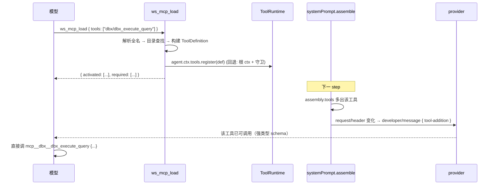

# MCP 工具按需加载（Lazy Tool Loading）设计与实施

> 状态：**已实施（P0–P4；默认值已改为 `lazy`，P5 折叠工具未做）**
> 日期：2026-10-18
> 适用包：`@dunlingzi/dsh-mcp-servers`（本仓库 `packages/dsh-mcp-servers`）
> 目标宿主：DeepSeek Harness `0.2.1-rc.2`（本机桌面版实测）
> 证据来源：本机 `D:\DeepSeekHarness\resources\app.asar` 内 `dsh-tools` / `dsh-llm` / `dsh-agent-loop` / `dsh-session` / `dsh-llm-deepseek` 打产物的逐段核对，以及本机会话 `cordis_inspect` 的 Tool provider 实测。
> 实施记录见文末 §13（含落地文件、与设计稿的差异、验证证据）。

---

## 0. TL;DR

1. **现状不是「插件没做收敛」，而是默认模式没覆盖全局服务器。** 插件默认 `middleware: project`，只把**项目级**服务器收进 `ws_mcp_*` 网关；`dbx`（43 个工具）、`codegraph`（1 个工具）是**全局**服务器，仍然全量注册 `mcp__*`，每轮请求都背着 **≈8.5k token** 的工具 schema。
2. **宿主 0.2.x 有原生「延迟加载」标记 `deferLoading: true`，但单独用它无效，甚至有害。** 官方文档原话：*declaring a deferred tool does not activate it*。被标记的工具只有在对话里出现一条 **`tool-addition`** 记录后才会真正提供给模型；而对「启动时就已进入 baseline」的工具，这条记录**永远不会产生** → 工具存在但不可调用。
3. **唯一可靠的激活通道是「晚注册」**：模型先调一个装载工具，插件在 **执行期** 调 `ctx.tools.register(...)`；下一步的 `systemPrompt.assemble()` 多出该工具 → 请求头与上一份 header 产生 diff → `dsh-agent-loop` 自动写 `developer/message` + `tool-addition` → DeepSeek 适配器转成 `tool_addition` 块（带 beta 头）。本机路由 `deepseek-flash` 已配置 `toolUpdate: addition-only`，这条路已验证可走。
4. **建议新增第 4 种模式 `lazy`**（语义 = `all` + 真实定义按需注册），默认常驻工具面从 44 个降到 3–5 个，稳态 ≈ **0.7k–3k token**，比现在的 8.5k 降 60%–90%。
5. **一条硬约束：装载后不要在会话中途卸载。** `addition-only` 路由会丢弃 `tool-removal` 记录，但历史里的 `tool_addition` 仍指向该工具，卸载会造成「引用了未声明的工具」的不一致状态。装载只在「会话销毁 / 服务器被删除」时回收；服务器断连时保留定义，让 `execute` 返回明确错误。

---

## 1. 现状量化

### 1.1 实测数据（本机，115 个工具位）

测量方法：`cordis_inspect_query` → Host `Tool` provider → `listTools`，对返回的每个工具做 `Buffer.byteLength(JSON.stringify(tool))`，token 按 `bytes / 4` 估算（英文技术描述的经验系数）。注意：中文描述的 UTF-8 字节 ≈ 3 B/字、约 1 token/字，`bytes / 4` 对中文是**低估**；本文涉及的 MCP 工具描述以英文为主，误差可接受，结论方向不变。

| 来源 | 工具数 | schema 体积 | ≈token/轮 |
|---|---:|---:|---:|
| `dbx`（全局，直挂） | 43 | 32,253 B | 8,063 |
| `codegraph`（全局，直挂） | 1 | 1,620 B | 405 |
| `ws_mcp_*` 网关 | 4 | 2,646 B | 662 |
| 宿主原生工具 | 67 | 57,381 B | 14,345 |
| **合计** | **115** | **93,900 B** | **23,475** |

MCP 部分占全部工具面的 **36%**（8,468 / 23,475）。其中 `dbx` 一家就占 8,063 token/轮——等同于每次请求都附带一份 8k token 的「工具说明书」，即使这一轮完全用不到数据库。

### 1.2 为什么是「一股脑」：模式矩阵

| `middleware` | 项目级服务器 | 全局服务器 | 常驻 MCP 工具面 |
|---|---|---|---|
| `off` | 直挂 `mcp__*` | 直挂 `mcp__*` | 全部工具 |
| `project`（**当前默认**） | 走 `ws_mcp_*` | **直挂 `mcp__*`** | 全局服务器全部工具 + 4 个网关工具 |
| `all` | 走 `ws_mcp_*` | 走 `ws_mcp_*` | 4 个网关工具 |
| `lazy`（本方案新增） | 按需注册 | 按需注册 | 3–5 个工具 + 已装载工具 |

相关代码位置：

- `src/config/model/config-schema.ts` → `middleware` 默认值 `"project"`。
- `src/connection/orchestrator/reconcile.ts` → `if (host.middlewareMode === "project" && want.scope === SCOPE_PROJECT) continue;`：只有**项目级**会被中间层接管（`ops.middlewareTakes` 在 `all` 模式下才覆盖全局）。
- `src/connection/runtime/supervisor.ts` → `syncTools()` 末尾 `this.manager.ctx.tools.register(definition)`：直挂路径把定义**全部**注册进全局注册表。

### 1.3 立即止血（不改代码）

设置 → **MCP 服务器** → 中间层模式改 `all` → 保存（热切换，无需重启）。全局服务器改由连接池接管、`mcp__*` 不再注册，MCP 面从 8,468 → **662 token**。这是本设计的 L0，先做，再谈 L2。

---

## 2. 宿主机制（0.2.1-rc.2 实测）

### 2.1 每 step 的工具装配链路

```
agent/pre-step
  └─ systemPrompt.assemble(ctx)               ← 每个 step 重新装配，不是每轮一次
       └─ ToolRuntime 的 tool provider: ctx.systemPrompt.tools(ctx => this.wireSchemas(ctx.scope))
            └─ assembly.tools = 当前 scope 可见的全部 schema（含 deferLoading 标记）
step()
  ├─ buildRequest(config, preparedCall, assembly.tools, ...)
  │    ├─ canonicalHeader({ config, tools })            ← 工具集进 request/header
  │    ├─ 与 baseline.tools 做名字 diff
  │    │    ├─ additions = 本次有、上次没有 → developer/message { type: "tool-addition", toolName }
  │    │    └─ removals  = 上次有、本次没有 → developer/message { type: "tool-removal", toolName }
  │    └─ session.append("developer/message", ...)
  └─ llm.stream(request)
       ├─ LlmRuntime 调 projectToolUpdates(messages, tools, modelInfo.toolUpdate, toolHistory)
       └─ adapter.serialize(...)
```

关键结论：

- **装配是每 step 一次**（`dsh-agent-loop` 的 `pre-step`：`const assembly = await this.loopCtx.systemPrompt.assemble(...)`），所以在第 N 步执行期间注册的工具，**第 N+1 步就会被看到**，不需要等下一轮。
- 新增工具的激活记录由 **`buildRequest` 的 header diff** 产生，没有别的入口。工具没有「新出现在 header 里」，就不会有 `tool-addition`。

### 2.2 `deferLoading` 的真实语义

`@deepseek-ai/dsh-tools` 的模型面 schema：

```ts
export interface ToolSchema {
  deferLoading?: true;
  name: string;
  description: string;
  parameters: Record<string, unknown>;
}
```

`defineTool()`、注册表投影（`schemaOf`）、系统提示词组装（`assemble`）都会**保留**这个标记。但它的作用止步于「告诉 provider：这个工具先别放进初始 prompt」：

`dsh-llm` 的 `projectToolUpdates()`：

```ts
if (toolUpdate === void 0) {
  // 路由不支持 mid-conversation tool updates → 剥掉标记，全量下发
  let immediateTools = tools;
  if (tools?.some(t => t.deferLoading === true))
    immediateTools = tools.map(({ deferLoading, ...tool }) => tool);
  return { messages: withoutDeveloperMessages(messages), tools: immediateTools };
}
const declarations = toolDeclarations(tools, toolUpdate, history);
const offered = new Set(history.tools.filter(t => !t.deferLoading).map(t => t.name));
```

`toolDeclarations()` 的注释写得很直白：

> *Explicitly deferred baseline tools become available only after their first retained addition.*

`dsh-tools/README.md` 亦明确：

> `deferLoading: true` … The marker requests deferred definition loading and **does not imply a `tool-addition` record**.

### 2.3 反模式：启动时全注册 + `deferLoading: true`

设想的写法：

```ts
// ❌ 错误示范
for (const tool of allMcpTools) ctx.tools.register({ ...buildDefinition(tool), deferLoading: true });
```

后果（对支持 tool update 的路由，如本机 `deepseek-flash`）：

1. 第一步的 `request/header` 就包含全部工具 → 它们属于 **baseline**；
2. provider 收到 `defer_loading: true`，初始 prompt 里没有它们的定义；
3. 但 `buildRequest` 的 diff 认为「它们本来就在」，**永远不会**为它们写 `tool-addition`；
4. `offered` 集合里也不含它们 → 模型既看不到、也调不动 → **哑弹**。

对**不支持** tool update 的路由，标记会被直接剥掉，工具照常全量下发 → **等于没写**。

额外陷阱：即使你只在某些工具上写 `deferLoading`，一旦请求进入新的 **series**（compaction / 系统提示变更 / `requestSurfaceGeneration` 变化），新 baseline 会重新形成，带标记的工具仍然等不到 addition，**它会在 series 重启后失效**，而你以为它一直是可用的。

> **结论：本方案中，懒加载工具一律不带 `deferLoading`。** 由宿主在 update 投影时自动补 `deferLoading: true`（`toolDeclarations` 会对 update 里的工具自动加），我们不需要也不能提前写。

### 2.4 激活通道：header diff → tool-addition

`dsh-agent-loop.buildRequest`（0.2.1-rc.2 打产物约 1241–1259 行）：

```ts
if (baseline !== void 0 && headerSeq !== void 0) {
  const previousNames = new Set(baseline.tools?.map(t => t.name));
  const currentNames  = new Set(tools.map(t => t.name));
  const additions = tools.filter(t => !previousNames.has(t.name))
                         .map(t => ({ type: "tool-addition", toolName: t.name }));
  const removals  = (baseline.tools ?? []).filter(t => !currentNames.has(t.name))
                         .map(t => ({ type: "tool-removal", toolName: t.name }));
  if (additions.length > 0 || removals.length > 0)
    session.append("developer/message", { message: createDeveloperMessage({ source: { kind: "tool-registry" }, content: [...additions, ...removals] }), headerSeq }, ...);
}
```

派发侧 `dsh-llm` 的 `projectToolUpdates` 再把 `tool-addition` 过滤成「只保留历史上还没 offer 过、且当前仍声明的工具」，DeepSeek 适配器 `serialize()` 把它转成：

```ts
{ role: "system", content: [{ type: "tool_addition", tool: { type: "tool_reference", name: block.toolName } }] }
```

并在存在 `tool_addition` / `tool_removal` 时带上 `MESSAGES_TOOL_CHANGES_BETA` 请求头。

**所以「按需加载」的实现只有一个关键动作：在需要的时候才 `register`。**

### 2.5 provider 能力矩阵

| 路由 | `toolUpdate` | 行为 |
|---|---|---|
| `deepseek-flash`（本机默认，`dsh-llm-deepseek`） | `addition-only` | 支持 mid-conversation `tool_addition`；**丢弃 `tool_removal` 记录** |
| `openai-completions` + `supportsMidConvoToolAdditions`（`dsh-llm-pi-ai`） | `addition-only` | 同上 |
| `anthropic-messages` + `supportsMidConvoToolChanges` | `in-history` | 增删都支持 |
| 其它 / 未声明 | `undefined` | 剥标记、全量下发；工具集变化会 `startsSeries` 重开 series |

本机 `profiles/desktop/cordis.patch.yml` 的 `llm-deepseek` 段已显式写：

```yaml
- id: deepseek-flash
  systemPromptUpdate: in-history
  toolUpdate: addition-only
```

> **推论（重要）**：`addition-only` 下「卸载」是不安全的——removal 记录会被丢掉，但历史里的 `tool_addition` 仍引用该工具，下一轮就会出现「引用未声明工具」。因此本设计**不做会话中途卸载**。

### 2.6 作用域模型

`ctx.tools.register(definition)` 的描述是：*Register globally or in the calling agent scope. Scoped tools shadow globals.*

- 插件根 ctx 注册 → **全局层**：所有 agent（含 subagent、teammate）都能看到 → 会话之间会串台。
- agent 自己的 ctx 注册 → **该 agent 的 own layer**：`ToolRuntime.view(scope)` 里 `own.tools` 无条件并入可见集合，而且 scope 销毁时随 fiber 一起回收。

`dsh-agent-loop` 创建 agent 时：

```ts
this.scope = createScope(loopCtx, this);
this.ctx = this.scope.ctx;
```

也就是说运行时 agent 对象上挂着 `ctx`。公开类型 `Agent` 只声明了 `id`，但 `agentPresets.serviceFor(agent: { ctx: Context }, name)` 的签名说明 **`{ ctx }` 是宿主认可的形状**。实现时按 `feature-detect + 回退` 处理：

```ts
const scoped = (exec.agent as { ctx?: { tools?: ToolRuntime } } | undefined)?.ctx?.tools;
const tools = scoped ?? manager.ctx.tools;
```

`tools.get(name, scope)` 的第二个参数是 `ScopeKey`，不是 ctx；要判断「本 agent 是否已装载」，用插件自己维护的 `WeakMap<Agent, Map<publicName, dispose>>` 更简单可靠。

### 2.7 可用 API 速查

| API | 用途 | 备注 |
|---|---|---|
| `ctx.tools.register(def): () => void` | 注册工具，返回精确 disposer | 同层重名会抛错，必须自己查重 |
| `ctx.tools.get(name, scope?)` | 按 scope 解析定义 | 见 2.6 |
| `ctx.tools.restrict({ allow, deny })` | 按 agent 掩蔽全局工具 | 掩码只交不并，**不能用来「后续放开」** |
| `ctx.tools.guard(fn)` | 单调守卫（返回 reason 即拒绝） | 经 `agent.ctx` 注册则只作用于该 agent |
| `ctx.systemPrompt.tools(provider)` | 贡献模型面 schema | 默认 provider 已由 ToolRuntime 注册，无需自造 |
| `ToolDefinition.output.schema` | 严格的 JSON Schema 子集 | 返回值必须命中，否则 `ToolOutputError` |
| `ToolDefinition.timeoutMs` | 声明式 | 不强制，实际超时由策略包装器管 |

---

## 3. 设计目标与约束

### 目标

- **G1** 会话启动时常驻 MCP 工具面 ≤ 5 个、≤ 900 token。
- **G2** 模型按需拿到**强类型**工具定义（不是通用 `ws_mcp_call` 的裸 JSON），减少参数错误。
- **G3** 保持现有三模式行为**逐字不变**，新能力以新模式 + 开关引入。
- **G4** 工具级禁用、`middlewarePolicy`、`ws_mcp_*` 三入口一致性契约不破。
- **G5** 失败可解释：装载失败、服务器未连、工具被禁，都要给模型下一步。

### 非目标

- 不做 MCP `resources` / `prompts`。
- 不做跨会话共享的「已装载集合」。
- 首版不实现「按相关性自动预装载」（留到有数据之后）。

### 硬约束

- **C1** 懒加载工具**不带** `deferLoading`。
- **C2** 会话中途**不卸载**（见 2.5）。
- **C3** 不得改变 `mcp__<server>__<tool>` 命名规则与 64 字符截断/哈希后缀。
- **C4** 注册必须幂等；同名重复装载返回 `alreadyLoaded` 而不是抛错。

---

## 4. 方案

### 4.1 模式模型

新增 `lazy`，语义上 **是 `all` 的超集**：

```
lazy = 全部服务器由中间层连接池持有（同 all）
     + 启动时不注册任何 mcp__ 工具
     + 提供 ws_mcp_load 按需注册
```

这样实现最省：连接、目录、策略、调用都复用既有中间层代码，只多一个「定义注册器」。

```ts
export type MiddlewareMode = "off" | "project" | "all" | "lazy";
```

模式兼容矩阵（`lazy` 之外的路径不得有任何行为变化）：

| 能力 | off | project | all | lazy |
|---|---|---|---|---|
| `mcp__*` 直挂 | ✅ | 仅全局 | ❌ | ❌（按需） |
| `ws_mcp_search/call/list/detail` | — | ✅ | ✅ | ✅ |
| `ws_mcp_load` | — | — | — | ✅ |
| 目录注入文案 | 直呼引导 | 双轨引导 | 全中间层引导 | 装载引导 |

**后续可选**：per-server `registration: "direct" | "lazy"`，让小服务器（如 `codegraph`，1 个工具 405 token）继续直挂，避免为它多一次装载往返。首版不做。

### 4.2 模型面工具

首版（保守，5 个）：

| 工具 | 变更 |
|---|---|
| `ws_mcp_search` | 不变（`lazy` 下 description 补一句「要直接调用请先 `ws_mcp_load`」） |
| `ws_mcp_list` | 不变 |
| `ws_mcp_detail` | 不变 |
| `ws_mcp_call` | 不变（保留为一次性调用的逃生口） |
| **`ws_mcp_load`** | **新增** |

常驻成本：4 个现有工具 2,646 B + `ws_mcp_load` ≈ 700 B ≈ **840 token**。

第二阶段（可选，单独 PR）：把 `list` / `detail` 折叠进 `search`（`query: ""` + `scope: "all"` 出全量；`detail: true` 出完整 schema），常驻降到 3 个 ≈ 500 token。

### 4.3 `ws_mcp_load` 契约

```ts
input: {
  tools?: string[];   // 精确名：支持三种写法
                      //   "mcp__dbx__dbx_execute_query"
                      //   "@<root>/dbx/dbx_execute_query"
                      //   "dbx/dbx_execute_query"
  query?: string;     // 关键词批量装载（与 tools 二选一，命中 top-N）
  limit?: number;     // query 批量时上限，默认 3，硬上限 8
}

output: {
  activated: Array<{
    name: string;        // mcp__dbx__dbx_execute_query
    server: string;      // @<root>/dbx
    tool: string;        // dbx_execute_query
    description: string; // 截断到 240 字符
    required: string[];  // 必填参数名（省掉一次 detail 往返）
  }>;
  alreadyLoaded: string[];
  missing: string[];
  unavailable: Array<{ server: string; reason: string }>;
  message: string;       // 给模型的一句话下一步
}
```

`render` 只输出紧凑文本（不吐完整 schema——schema 已经在下一步的模型面里了，重复会浪费上下文）。

### 4.4 时序



### 4.5 生命周期

| 事件 | 动作 |
|---|---|
| 模型调用 `ws_mcp_load` | 构建定义 → 注册（幂等）→ 记入 `WeakMap<Agent, Map<name, dispose>>` |
| 模型调用已装载工具 | 走定义内的 `execute` → `mw.callTool(...)`（策略/禁用/超时/截断同源） |
| 服务器断连 | **定义保留**；`execute` 返回「未连接，可重连」错误 |
| 服务器被删除 / 改名 | `registrar.disposeServer(name)` 精确注销（agent 侧桶 + 全局回退都扫）；在 `manager.removeServer` 里接一行即可 |
| agent 销毁 | scope 层注册随 fiber 自动回收；WeakMap 条目随之可达性丢失 |
| 会话中途 | **不卸载**（C2） |

### 4.6 与既有子系统的关系

- **能力目录注入**（`catalog/injection.ts`）：继续保留，它是「菜单」。`lazy` 下把引导句改成「先用 search 找，再 `ws_mcp_load` 装载，再直呼」。
- **工具级禁用**（`pipeline/authorize.ts`）：`ws_mcp_load` **装载时就拒绝**被禁用/被策略拒绝的工具（早失败，避免「装载了却调不动」）；`execute` 仍走 `callTool` 二次裁决（保持三入口一致）。
- **策略**：`allowTools/denyTools` 不新增语义；装载阶段用 `policyAllows` 预检。
- **统计**：`McpStatsCollector` 增加 `recordLoad(server, tool)` 与 `loadedTools` 快照字段。
- **路由/UI**：`middleware` 枚举新增 `lazy`，设置页下拉加一项；`GET /config` 原样返回。

---

## 5. 详细实施

### 5.1 类型与配置

`src/types/middleware-types.ts`

```ts
/** 中间层模式：off = 直呼；project = 项目级走中间层；all = 全部走中间层；lazy = all + 按需注册真实定义。 */
export type MiddlewareMode = "off" | "project" | "all" | "lazy";

/** ws_mcp_load 的单个装载结果。 */
export interface LoadedToolEntry {
  name: string;
  server: string;
  tool: string;
  description: string;
  required: string[];
}

export interface LoadResult {
  activated: LoadedToolEntry[];
  alreadyLoaded: string[];
  missing: string[];
  unavailable: Array<{ server: string; reason: string }>;
  message: string;
}
```

`src/workspace/middleware-mode.ts`

```ts
export function normalizeMiddlewareMode(value: string): MiddlewareMode {
  return value === "project" || value === "all" || value === "lazy" ? value : "off";
}
```

> 注意：`normalizeMiddlewareMode` 现在的实现是 `value === "project" || value === "all" ? value : "off"`，新增值必须同步，否则设置页存进去会被立刻归一化成 `off`（静默降级，最难查的一类 bug）。

`src/config/model/config-schema.ts`

```ts
middleware: z.union([z.const("off"), z.const("project"), z.const("all"), z.const("lazy")])
  .default("project")
  .description("MCP 中间层模式：off=直接注册 mcp__ 工具；project=项目级走 ws_mcp_*（默认）；all=全部走中间层；lazy=all + 按需 ws_mcp_load 装载真实定义"),
```

**P4 起默认值为 `lazy`**：`config-schema.ts` 的 `.default("lazy")` 与
`apply-config.ts` 的回落字面量**必须同源**（两处漂移会造成「配置文件缺省走 lazy、
代码缺省走 project」的分裂，且极难查）。已有用户若在设置页保存过其它模式，以持久化值
为准；切回旧口径在设置页选 `project` / `all` / `off` 即可（热生效，无需重启）。

### 5.2 新增 `src/inject/lazy-registrar.ts`

职责：持有「谁装载了什么」，构建 `ToolDefinition`，提供幂等注册与精确释放。

```ts
/**
 * dsh-mcp-servers — inject/lazy-registrar.ts
 *
 * 按需注册：把中间层目录里的单工具投影成真实 ToolDefinition，注册进
 * 「调用者 agent 的作用域」（不可得时回退全局层 + 守卫）。
 * 约束：C1 不写 deferLoading；C2 会话中途不卸载；C4 幂等。
 */

import type { ToolDefinition } from "@deepseek-ai/dsh-tools";
import type { Context } from "@deepseek-ai/cordis";
import { publicToolName } from "../connection/runtime/interface.ts";
import { fullServerName } from "../workspace/interface.ts";
import type { McpMiddleware } from "../connection/runtime/interface.ts";

interface LoadedEntry {
  dispose: () => void;
  server: string;
  tool: string;
}

/** agent（或全局回退槽）→ publicName → 装载记录。 */
const loadedByAgent = new WeakMap<object, Map<string, LoadedEntry>>();
/** 全局回退（取不到 agent.ctx 时）：publicName → 装载记录。 */
const globalLoaded = new Map<string, LoadedEntry>();
/** 所有 agent 侧的装载桶：WeakMap 不可枚举，另存一份供服务器删除 / 全量清理遍历。 */
const allBuckets = new Set<Map<string, LoadedEntry>>();

function registrarFor(agent: unknown): { tools: { register(d: ToolDefinition): () => void } | undefined; key: object | undefined } {
  const scoped = (agent as { ctx?: { tools?: { register(d: ToolDefinition): () => void } } } | undefined)?.ctx?.tools;
  if (scoped !== undefined) return { tools: scoped, key: agent as object };
  return { tools: undefined, key: undefined };
}

/** 构建单个 MCP 工具的模型面定义；execute 复用中间层 callTool，保持策略/禁用/超时同源。 */
export function buildLazyDefinition(
  mw: McpMiddleware,
  root: string,
  server: string,
  tool: string,
  inputSchema: Record<string, unknown>,
  description: string,
): ToolDefinition {
  const serverFull = fullServerName(root, server);
  return {
    name: publicToolName(server, tool),
    description,
    parameters: inputSchema,
    output: {
      schema: {
        type: "object",
        properties: { content: { type: "array", items: {} }, structuredContent: {} },
        required: ["content"],
        additionalProperties: false,
      },
      render(_args: unknown, value: unknown) {
        const content = Array.isArray((value as { content?: unknown })?.content) ? (value as { content: unknown[] }).content : [];
        const text = content
          .map((block) => {
            const rec = (block ?? {}) as Record<string, unknown>;
            if (rec.type === "text" && typeof rec.text === "string") return rec.text;
            if (rec.type === "resource" || rec.type === "resource_link") return "[resource: content discarded]";
            return `[${String(rec.type ?? "unknown")} content]`;
          })
          .join("\n");
        return [{ type: "text" as const, text: text !== "" ? text : "(MCP tool returned no content)" }];
      },
    },
    isConcurrencySafe: () => true,
    execute: (args, exec) => mw.callTool(serverFull, tool, args, exec.signal, exec.agent),
  };
}

export interface Registrar {
  load(agent: unknown, definitions: Array<{ definition: ToolDefinition; server: string; tool: string }>): {
    activated: string[];
    alreadyLoaded: string[];
  };
  isLoadedBy(agent: unknown, publicName: string): boolean;
  disposeAgent(agent: unknown): void;
  disposeServer(server: string): void;
  disposeAll(): void;
}

export function createRegistrar(ctx: Context): Registrar {
  return {
    load(agent, definitions) {
      const activated: string[] = [];
      const alreadyLoaded: string[] = [];
      const scoped = registrarFor(agent);
      const bucket = scoped.key === undefined ? undefined : (loadedByAgent.get(scoped.key) ?? new Map<string, LoadedEntry>());
      if (scoped.key !== undefined && bucket !== undefined && !loadedByAgent.has(scoped.key)) {
        loadedByAgent.set(scoped.key, bucket);
        allBuckets.add(bucket);
      }

      for (const { definition, server, tool } of definitions) {
        const name = definition.name;
        const own = bucket?.has(name) === true;
        const shared = globalLoaded.has(name);
        if (own || (scoped.tools === undefined && shared)) {
          alreadyLoaded.push(name);
          continue;
        }
        if (scoped.tools !== undefined) {
          // agent 作用域：不会跨会话可见，重复注册才会抛错——上面已查重。
          const dispose = scoped.tools.register(definition);
          bucket?.set(name, { dispose, server, tool });
          activated.push(name);
        } else {
          // 全局回退：同 publicName 只注册一次（C4 幂等），不做引用计数——
          // C2 决定了会话中途不卸载，计数只会增加出错面。
          const dispose = (ctx.tools as { register(d: ToolDefinition): () => void }).register(definition);
          globalLoaded.set(name, { dispose, server, tool });
          activated.push(name);
        }
      }
      return { activated, alreadyLoaded };
    },

    isLoadedBy(agent, publicName) {
      const key = registrarFor(agent).key;
      return key !== undefined && loadedByAgent.get(key)?.has(publicName) === true;
    },

    disposeAgent(agent) {
      const key = registrarFor(agent).key;
      if (key === undefined) return;
      const bucket = loadedByAgent.get(key);
      if (bucket !== undefined) {
        for (const entry of bucket.values()) entry.dispose();
        allBuckets.delete(bucket);
      }
      loadedByAgent.delete(key);
    },

    disposeServer(server) {
      for (const [name, entry] of globalLoaded) {
        if (entry.server !== server) continue;
        entry.dispose();
        globalLoaded.delete(name);
      }
      for (const bucket of allBuckets) {
        for (const [name, entry] of bucket) {
          if (entry.server !== server) continue;
          entry.dispose();
          bucket.delete(name);
        }
      }
    },

    disposeAll() {
      for (const entry of globalLoaded.values()) entry.dispose();
      globalLoaded.clear();
      for (const bucket of allBuckets) for (const entry of bucket.values()) entry.dispose();
      allBuckets.clear();
    },
  };
}
```

要点：

- **不要**在 `buildLazyDefinition` 里加 `deferLoading`（C1）。
- `execute` 走 `mw.callTool` 而不是自己拼 `client.callTool`：策略、禁用、超时、截断、`structuredContent` 投影全部同源，三入口一致性契约零代价继承。
- 全局回退路径按 `publicName` **只注册一次**（C4 幂等），不做引用计数：C2 决定了会话中途不卸载，计数只会增加出错面；真正的回收只发生在 `disposeServer` / `disposeAll`。

### 5.3 新增 `src/inject/tools/load.ts`

沿用 `detail.ts` / `call.ts` 的写法（纯函数解析 + 执行 + 组装）：

```ts
/**
 * dsh-mcp-servers — inject/tools/load.ts
 *
 * ws_mcp_load：把目录里的真实工具定义按需注册进调用者作用域。
 * 装载成功后，下一步的系统提示词装配会自动产生 tool-addition，
 * 模型即可直接调用 mcp__<server>__<tool>。
 */

import type { ToolDefinition } from "@deepseek-ai/dsh-tools";
import { searchCatalogMulti } from "../../catalog/interface.ts";
import { parseFullServerName, fullServerName } from "../../workspace/interface.ts";
import { policyAllows, isToolDenied } from "../../pipeline/interface.ts";
import { type MiddlewareToolContext, checkMiddlewareRoot, visibleMiddlewareRoots, waitForDiscovery } from "../middleware-shared.ts";
import type { LoadedToolEntry, LoadResult } from "../../types/interface.ts";

const LOAD_LIMIT_DEFAULT = 3;
const LOAD_LIMIT_MAX = 8;
const LOAD_DESC_MAX = 240;

type Parsed = { tools: string[]; query: string; limit: number };

function parseLoadParams(args: unknown): Parsed {
  const params = (typeof args === "object" && args !== null ? args : {}) as Record<string, unknown>;
  const tools = Array.isArray(params.tools) ? params.tools.filter((t): t is string => typeof t === "string" && t !== "") : [];
  const query = typeof params.query === "string" ? params.query.trim() : "";
  const rawLimit = typeof params.limit === "number" && Number.isFinite(params.limit) ? Math.floor(params.limit) : LOAD_LIMIT_DEFAULT;
  return { tools, query, limit: Math.min(Math.max(rawLimit, 1), LOAD_LIMIT_MAX) };
}

/** "mcp__srv__tool" / "@root/srv/tool" / "srv/tool" / "srv.tool" → { server, tool } */
function normalizeRef(ref: string, root: string): { serverFull: string; server: string; tool: string } | undefined {
  let rest = ref.trim();
  if (rest.startsWith("mcp__")) rest = rest.slice("mcp__".length);
  const at = rest.indexOf("/");
  // "@root/srv/tool" 形态
  if (rest.startsWith("@") && at > 0) {
    const parts = rest.split("/");
    if (parts.length !== 3) return undefined;
    return { serverFull: `${parts[0]}/${parts[1]}`, server: parts[1], tool: parts[2] };
  }
  const sep = rest.indexOf("__");
  if (sep > 0) {
    const server = rest.slice(0, sep);
    const tool = rest.slice(sep + 2);
    return tool === "" ? undefined : { serverFull: fullServerName(root, server), server, tool };
  }
  const slash = rest.indexOf("/");
  if (slash > 0) {
    const server = rest.slice(0, slash);
    const tool = rest.slice(slash + 1);
    return tool === "" ? undefined : { serverFull: fullServerName(root, server), server, tool };
  }
  return undefined;
}

function renderLoadOutput(_args: unknown, value: unknown) {
  const v = (value ?? {}) as Partial<LoadResult>;
  const lines: string[] = [];
  for (const item of v.activated ?? []) {
    const req = item.required.length > 0 ? ` required: ${item.required.join(", ")}` : " (no required params)";
    lines.push(`✔ ${item.name}${req} — ${item.description}`);
  }
  if ((v.alreadyLoaded ?? []).length > 0) lines.push(`• already loaded: ${(v.alreadyLoaded ?? []).join(", ")}`);
  if ((v.missing ?? []).length > 0) lines.push(`✘ not found: ${(v.missing ?? []).join(", ")}`);
  for (const u of v.unavailable ?? []) lines.push(`! ${u.server} unavailable: ${u.reason}`);
  if (v.message !== undefined) lines.push(v.message);
  return [{ type: "text" as const, text: lines.join("\n") }];
}

export function buildLoadTool(toolCtx: MiddlewareToolContext, registrar: Registrar): ToolDefinition {
  async function executeLoad(args: unknown, exec: { agent?: unknown }) {
    const root = await toolCtx.resolveRoot(exec.agent);
    if (root === undefined) throw new Error("ws_mcp_load: 无法确定工作空间，请先选择工作区");
    const { tools: refs, query, limit } = parseLoadParams(args);
    if (refs.length === 0 && query === "") throw new Error("ws_mcp_load: 需要 tools 或 query");

    const roots = visibleMiddlewareRoots(root, toolCtx.mode);
    // 建立候选集：精确名 → 目录查找；query → 检索 top-N
    const wanted: Array<{ serverFull: string; server: string; tool: string }> = [];
    const missing: string[] = [];
    for (const ref of refs) {
      const parsed = normalizeRef(ref, root);
      if (parsed === undefined) { missing.push(ref); continue; }
      wanted.push(parsed);
    }
    const unavailable: Array<{ server: string; reason: string }> = [];
    if (query !== "") {
      const search = searchCatalogMulti(toolCtx.mw.units, roots, query, limit);
      for (const hit of search.results) {
        const parsed = parseFullServerName(hit.server);
        if (parsed === undefined) continue;
        wanted.push({ serverFull: hit.server, server: parsed.server, tool: hit.tool });
      }
      unavailable.push(...search.unavailable);
    }

    const definitions: Array<{ definition: ToolDefinition; server: string; tool: string }> = [];
    const activatedMeta: LoadedToolEntry[] = [];
    for (const want of wanted) {
      const targetRoot = await checkMiddlewareRoot("ws_mcp_load", want.serverFull, root, toolCtx.mode, toolCtx.mw);
      if (targetRoot === undefined) { missing.push(`${want.serverFull}/${want.tool}`); continue; }
      await toolCtx.mw.ensureConnected(targetRoot, want.server);
      const unit = await toolCtx.mw.projectUnitFor(targetRoot);
      if (unit !== undefined) await waitForDiscovery(unit);
      const catalog = unit?.catalog.get(want.server);
      const entry = catalog?.tools.get(want.tool);
      if (entry === undefined) { missing.push(`${want.serverFull}/${want.tool}`); continue; }
      // 早失败：禁用 / 策略拒绝的工具不装载（避免「装上了调不动」）
      const policyKey = fullServerName(targetRoot, want.server);
      if (isToolDenied(toolCtx.mw.disabledTools, toolCtx.mw.policy, policyKey, want.tool)) {
        throw new Error(`ws_mcp_load: 工具 ${JSON.stringify(`${policyKey}/${want.tool}`)} 已被禁用或被策略拒绝；如需放行请调整 middlewarePolicy 配置`);
      }
      if (!policyAllows(toolCtx.mw.policy, policyKey, want.tool)) {
        throw new Error(`ws_mcp_load: 工具 ${JSON.stringify(`${policyKey}/${want.tool}`)} 不在 allowTools 白名单内`);
      }
      const description = entry.description !== "" ? entry.description : `MCP tool ${want.tool} on ${want.serverFull}`;
      const params = (entry.inputSchema ?? {}) as Record<string, unknown>;
      const required = Array.isArray(params.required) ? (params.required as string[]) : [];
      definitions.push({
        server: want.server,
        tool: want.tool,
        definition: buildLazyDefinition(toolCtx.mw, targetRoot, want.server, want.tool, params, description),
      });
      activatedMeta.push({
        name: publicToolName(want.server, want.tool),
        server: want.serverFull,
        tool: want.tool,
        description: description.length > LOAD_DESC_MAX ? `${description.slice(0, LOAD_DESC_MAX - 1)}…` : description,
        required,
      });
      toolCtx.stats?.recordLoad?.(want.server, want.tool);
    }

    const { activated, alreadyLoaded } = registrar.load(exec.agent, definitions);
    const okNames = new Set(activated);
    const result: LoadResult = {
      activated: activatedMeta.filter((m) => okNames.has(m.name)),
      alreadyLoaded,
      missing,
      unavailable,
      message: activated.length > 0
        ? `已装载 ${activated.length} 个工具，下一步可直接调用：${activated.join(", ")}`
        : "没有新装载的工具；已装载的可直接调用，未找到的请先用 ws_mcp_search 检索。",
    };
    return result;
  }

  return {
    name: "ws_mcp_load",
    description:
      "Load real MCP tool definitions into this session on demand, so the next step exposes the typed mcp__<server>__<tool> tool. Use it after ws_mcp_search/list identifies a tool you need; repeat calls are idempotent. Prefer this over repeated ws_mcp_call for tools you will use more than once.",
    parameters: {
      type: "object",
      properties: {
        tools: {
          type: "array",
          items: { type: "string" },
          description: 'Exact tool refs: "mcp__<server>__<tool>", "@<root>/<server>/<tool>" or "<server>/<tool>". Batch up to 8.',
        },
        query: { type: "string", description: "Keyword batch load (alternative to tools): loads the top matches." },
        limit: { type: "number", description: "When using query: max tools to load (default 3, max 8)." },
      },
      required: [],
    },
    output: {
      schema: {
        type: "object",
        properties: {
          activated: {
            type: "array",
            items: {
              type: "object",
              properties: {
                name: { type: "string" },
                server: { type: "string" },
                tool: { type: "string" },
                description: { type: "string" },
                required: { type: "array", items: { type: "string" } },
              },
              required: ["name", "server", "tool", "description", "required"],
              additionalProperties: false,
            },
          },
          alreadyLoaded: { type: "array", items: { type: "string" } },
          missing: { type: "array", items: { type: "string" } },
          unavailable: {
            type: "array",
            items: {
              type: "object",
              properties: { server: { type: "string" }, reason: { type: "string" } },
              required: ["server", "reason"],
              additionalProperties: false,
            },
          },
          message: { type: "string" },
        },
        required: ["activated", "alreadyLoaded", "missing", "unavailable", "message"],
        additionalProperties: false,
      },
      render: renderLoadOutput,
    },
    isConcurrencySafe: () => true,
    execute: (args, exec) => executeLoad(args, exec),
  };
}
```

> `required` 字段请按宿主的 JSON Schema 子集校验（`dsh-tools/json-schema`）：`type/properties/required/additionalProperties/items/enum/const/oneOf`，不要写 `minItems` 之类不支持的键。

### 5.4 注册面装配：`src/inject/middleware-register.ts`

```ts
export function registerMiddlewareTools(
  ctx: Context,
  mw: McpMiddleware,
  resolveRoot: (agent: unknown) => Promise<string | undefined>,
  mode: MiddlewareMode = "project",
  options: { disabledTools?: DisabledToolsMap; stats?: McpStatsCollector; registrar?: Registrar } = {},
): () => void {
  const disabledTools = options.disabledTools ?? mw.disabledTools;
  if (options.disabledTools !== undefined) mw.disabledTools = disabledTools;

  const toolCtx: MiddlewareToolContext = { mw, resolveRoot, mode, stats: options.stats };
  const tools = [
    buildSearchTool(toolCtx),
    buildCallTool(toolCtx),
    buildListTool(toolCtx),
    buildDetailTool(toolCtx),
    // lazy 模式才暴露装载器：其它模式下没有「未注册的真实工具」，暴露只会误导模型
    ...(mode === "lazy" && options.registrar !== undefined ? [buildLoadTool(toolCtx, options.registrar)] : []),
  ];
  const disposers: Array<() => void> = [];
  for (const tool of tools) disposers.push(ctx.tools.register(tool));
  const guardDispose = registerPreExecuteGuard(ctx, mw, resolveRoot, options.registrar);
  if (guardDispose !== undefined) disposers.push(guardDispose);
  return () => { for (const dispose of disposers) dispose(); };
}
```

`MiddlewareToolContext` 增加可选字段：

```ts
export interface MiddlewareToolContext {
  mw: McpMiddleware;
  resolveRoot: (agent: unknown) => Promise<string | undefined>;
  mode: MiddlewareMode;
  stats?: McpStatsCollector;
}
```

（`registrar` 走 `buildLoadTool` 的第二参数传入，不改这个共享结构，减少波及面。）

### 5.5 守卫：未装载的工具要给出可行动的拒绝

在 `registerPreExecuteGuard` 里追加一条分支（**只对 `lazy` 模式**）：

```ts
if (name.startsWith("mcp__") && registrar !== undefined && !registrar.isLoadedBy(exec.agent, name)) {
  return {
    kind: "deny",
    reason: `工具 ${name} 尚未在本会话装载；请先调用 ws_mcp_load（例如 {"tools":["${name}"]}），装载后下一步即可直接调用`,
  };
}
```

这条守卫只在「全局回退注册」时才有意义——agent 作用域注册时，其它 agent 根本看不到这些工具（`view()` 只并入 own layer）。两条一起上，是纵深防御。

### 5.6 supervisor 直挂路径 / 接管判定

`lazy` 模式下全局服务器必须由中间层接管（同 `all`），`supervisor.syncTools()` 不会被调用；但 `off` / `project` 模式下它仍在用。**首版不改 `syncTools` 的既有行为**，只改接管判定。

接管判定的**单一事实源**在 `src/connection/orchestrator/middleware-bridge.ts:38`（不在 manager 里，manager 只是转发）：

```ts
// 现状
export function middlewareTakes(host: MiddlewareHost, name: string, scope: string): boolean {
  if (host.middlewareMode === "off" || host.middleware === undefined) return false;
  if (scope === SCOPE_PROJECT) return true;
  return host.middlewareMode === "all" && scope === SCOPE_GLOBAL;
}
```

改为：

```ts
export function middlewareTakes(host: MiddlewareHost, name: string, scope: string): boolean {
  if (host.middlewareMode === "off" || host.middleware === undefined) return false;
  if (scope === SCOPE_PROJECT) return true;
  // all 与 lazy 同口径：全局服务器交给连接池
  return coversGlobal(host.middlewareMode) && scope === SCOPE_GLOBAL;
}
```

`coversGlobal()` 建议放在 `src/workspace/middleware-mode.ts`（见 §5.10）。如果漏改这一处，症状是**双进程**：同一个 MCP 服务器被 supervisor 和连接池各拉一个子进程，工具也重复注册（`ctx.tools.register` 重名抛错，或一个 server 出现两套连接状态）。

### 5.7 文案（三处必须一起改，否则模型被自相矛盾的引导带偏）

1. `src/bootstrap/apply-guidance.ts` → `MCP_GUIDANCE`：

   ```ts
   "- Lazy mode (lazy): the tool list only carries ws_mcp_* tools. Find a tool with `ws_mcp_search`, load it with `ws_mcp_load`, then call the typed `mcp__<server>__<tool>` directly (do not loop through ws_mcp_call for repeated use).\n"
   ```

   现有「Do NOT call mcp__ prefixed tools directly」在 `lazy` 下是**反的**，必须按模式渲染（`MCP_GUIDANCE` 目前是常量，需要改成函数 `mcpGuidance(mode)` 并在 `apply.ts` 注册 section 时按 `manager.middlewareMode` 取文本；注意热切换时要重注册 section）。

2. `src/catalog/entries.ts` → `renderMcpCatalogMessage` / `renderMcpCatalogUpdate`：`lazy` 分支加装载引导，并说明「目录只列服务器与摘要，工具名用 `ws_mcp_search` 找」。

3. 工具 description：`ws_mcp_search` / `ws_mcp_call` 各补一句「lazy 模式下建议先 load」。

> 现有 `MCP_GUIDANCE` 是 `order: 160` 的静态 section。改函数化后，`setMiddlewareMode` 热切换必须同步替换该 section（当前 `apply-runtime.ts` 的热切换只重建中间层工具，不重注册 section）。

### 5.8 客户端与路由

| 文件 | 改动 |
|---|---|
| `src/api/routes-controllers.ts` | `middleware` 校验白名单加 `lazy`（现在是 `off/project/all` 三选一，写 `lazy` 会被 400） |
| `src/client/page/ListView.tsx:406-415` | 下拉加 `<option value="lazy">`（放在 `all` 之后） |
| `src/client/page/McpServersPage.tsx:53` | 状态初值 `useState("project" as string)` 本身兼容，核对下发/回读的类型收窄 |
| `src/client/locales.ts` | `middlewareLazy` 中英文案 + 说明行 |
| `src/client/core/constants.ts` | 若有模式→颜色的映射，补 `lazy` |
| `README.md` / `README.en.md` | 配置表 `middleware` 值域加 `lazy`；「核心优势」补一段 |

### 5.9 统计

`src/stats/types.ts` 加：

```ts
/** ws_mcp_load 装载次数（server/tool → 次数）。 */
loadCounts: Record<string, number>;
/** 当前已装载工具数（快照）。 */
loadedTools: number;
```

`collector.ts` 加 `recordLoad(server, tool)`；`render` 里输出装载漏斗（search → detail → load → call）。

### 5.10 模式分支单点清单（**漏一处就静默降级**）

`lazy` 在语义上是 `all` 的超集，但代码里「是否覆盖全局服务器」的判断目前**散落在 8 处**，全部写死 `=== "all"`。建议先加一个判定函数，再逐点替换：

```ts
// src/workspace/middleware-mode.ts
/** 中间层是否覆盖全局服务器（all / lazy 同口径）。 */
export function coversGlobal(mode: MiddlewareMode): boolean {
  return mode === "all" || mode === "lazy";
}
```

| # | 文件:行 | 现状 | 改为 | 漏改的症状 |
|---|---|---|---|---|
| 1 | `connection/orchestrator/middleware-bridge.ts:41` | `mode === "all" && scope === GLOBAL` | `coversGlobal(mode) && scope === GLOBAL` | 双进程 / 工具重复注册 |
| 2 | `workspace/root-resolution.ts:60` | `if (manager.middlewareMode === "all")` | `if (coversGlobal(...))` | **无项目 cwd 时 `resolveRoot` 返回 undefined → `ws_mcp_load` 报「无法确定工作空间」，整个 lazy 模式形同虚设** |
| 3 | `inject/middleware-shared.ts:38` | `if (mode !== "all") return [root];` | `if (!coversGlobal(mode)) return [root];` | `ws_mcp_search/load` 看不到 `@global` 单元里的全局工具 |
| 4 | `inject/middleware-shared.ts:66` | `if (parsed.root === GLOBAL && mode !== "all")` | `&& !coversGlobal(mode)` | `checkMiddlewareRoot` 把全局工具当「不属于本工作空间」硬拒绝 |
| 5 | `catalog/entries.ts:199,204` | `mode === "all" ? 全局引导 : 直呼引导` | `coversGlobal(mode) ? ...` | 能力目录一边说「全局直呼 mcp__」、一边又不注册 → 模型按错的方式调用 |
| 6 | `inject/tools/list.ts:89,101` | `mode === "all" ? ...` | `coversGlobal(mode)` | `ws_mcp_list` 的 root 选择与文案错 |
| 7 | `connection/orchestrator/manager.ts:440`（`refreshFromDisk`）、`:472`（`resumeReconnect`）、`:743`（断开路由） | `middlewareMode === "all" ? MIDDLEWARE_GLOBAL_ROOT : undefined` | `coversGlobal(...)` | 配置热更 / 回前台恢复 / 断开时定位不到 `@global` 单元，全局连接不重建、断开不生效 |
| 8 | `api/routes-controllers.ts:89`、`workspace/middleware-mode.ts:13`、`config/model/config-schema.ts:47`、`types/middleware-types.ts:13`、`client/page/ListView.tsx:414`（下拉）、`client/locales.ts` | 三值枚举 | 四值枚举 | 设置页存 `lazy` 被 400 拒绝，或被归一化成 `off`（**静默降级**，最难查） |

推荐顺序：**先改 2、3、4（决定 lazy 能不能跑）→ 1（决定会不会双进程）→ 5、6（文案）→ 7（生命周期）→ 8（入口）**，每步都能单独跑单测。

---

## 6. 测试计划

现有测试分层：`test/unit`（直连 `src/`）、`test/integration`、`test/e2e`（读产物）。新增用例遵循同样分层。

| 层级 | 用例 | 断言 |
|---|---|---|
| unit | `normalizeRef` 四种写法 | 三种前缀都解析到同一 `{serverFull, tool}`；非法输入进 `missing` |
| unit | `registrar.load` 幂等 | 同名二次装载返回 `alreadyLoaded`，`register` 只调一次 |
| unit | `registrar.load` 走 agent 作用域 | `exec.agent.ctx.tools.register` 被调用，根 ctx 未被调用 |
| unit | 全局回退去重 | 两个 agent 装载同名工具 → `register` 只调一次，第二次进 `alreadyLoaded` |
| unit | `disposeServer` | 删除服务器后，agent 侧桶与全局回退里该服务器的工具全部 `dispose` |
| unit | 禁用/策略早失败 | 被禁工具不进入 `register`，抛错文案含「ws_mcp_load」 |
| unit | `ws_mcp_load` 输出 schema | 返回值通过宿主 JSON Schema 校验（`validateJsonSchemaValue` 同款子集） |
| unit | 模式归一化 | `"lazy"` 归一化后仍是 `"lazy"`（防静默降级成 `off`） |
| unit | `coversGlobal` | `off/project` → false；`all/lazy` → true |
| unit | `resolveRoot` 无项目 cwd | `lazy` 且有全局服务器 → 回落 `@global`；`project` → `undefined`（保持现状） |
| integration | `middlewareTakes` | `lazy` + `SCOPE_GLOBAL` → true，且不创建 supervisor（无双进程） |
| integration | `registerMiddlewareTools(mode="lazy")` | 注册 5 个工具；`project/all` 仍注册 4 个 |
| integration | 守卫 | 未装载 `mcp__x__y` → deny 且 reason 含 `ws_mcp_load`；已装载 → `next()` |
| integration | 热切换 `all → lazy` | 旧 disposer 全部释放，新装载器可用，无重复注册抛错 |
| e2e | 假 MCP server 端到端 | connect → search → load → 下一步 header 含新增工具 → 调用成功 → 结果投影正确 |
| e2e | 断连语义 | load 后断开 server → 定义仍在 → 调用返回「未连接」而不是 `UNKNOWN_TOOL` |
| e2e | 不卸载 | 会话中途切走/切回，工具仍在（不产生 `tool-removal`） |

> `test/e2e/smoke.test.ts` 已经很大（≈140 KB），新增断言建议放到独立文件，避免继续膨胀；新增文件后按 README 的固定动作同步测试下限：
> `node scripts/gate/gen-stryker-conf.mjs --sync-test-min` → `pnpm stryker:gen`。

---

## 7. 验收指标

| 指标 | 现状 | 目标 | 测量方式 |
|---|---:|---:|---|
| 常驻 MCP 工具位 | 44 | ≤ 5 | `cordis_inspect` → Tool provider → 按 `mcp__` 前缀过滤计数 |
| 常驻 MCP schema | 33.9 KB ≈ 8.5k tok | ≤ 3.5 KB ≈ 0.9k tok | 同上，`JSON.stringify` 字节数 / 4 |
| 典型会话装载数 | — | 3–5 | 插件 stats `loadCounts` 汇总 |
| 装载后稳态 | — | ≤ 4k tok | 常驻 + 已装载 schema 求和 |
| 首调额外延迟 | 0 | ≤ 1 个 step（≈ 一次模型往返 + 0.3 s） | 会话日志 `step` 时间差 |
| 装载失败可解释率 | — | 100%（missing/unavailable/denied 三分类都有下一步） | e2e 断言 |

**验收脚本（本机一次性）**：起一个会话 → 调一次 `ws_mcp_search` + `ws_mcp_load` → 用 `cordis_inspect_query` 的 Tool provider 抓全量 schema → 按 `mcp__` 前缀分组算字节数，与上表对比。此法不需要改代码，也不依赖插件自身的统计。

---

## 8. 风险与回滚

| 风险 | 触发条件 | 缓解 |
|---|---|---|
| 模型不主动装载，反复失败 | 引导文案没同步（§5.7） | 三处文案同 PR 一起改；e2e 覆盖 |
| 全局回退注册串台 | `exec.agent.ctx` 取不到 | 守卫兜底拒绝；日志记 `scoped=false` 便于观测 |
| `addition-only` 路由上的拆除不一致 | 任何中途卸载 | **不卸载**（C2）；断连只让 `execute` 报错 |
| 双进程（supervisor + 中间层同时连） | `middlewareTakes` 没把 `lazy` 归到 `all` 分支 | §5.6 显式核对；e2e 数子进程 |
| 设置页写入被归一化成 `off` | `normalizeMiddlewareMode` 漏改 | 单测覆盖；`GET /config` 回读校验 |
| 热切换后 section 仍是旧文案 | `apply-runtime.ts` 只重建了工具 | 热切换里同时 `disposeSection` + 重注册 |
| 常驻反而变大 | 模型每个会话都 load 十几把工具 | `limit` 硬上限 8；stats 观测；必要时加「装载 LRU 告警」（不自动卸载） |

**回滚**：模式是一个枚举值，回滚 = 设置页切回 `all`/`project`（热生效）。代码回滚按 PR 粒度 revert；新增字段（`loadCounts` 等）对旧读端是可选字段，不需要数据迁移。

---

## 9. PR 拆分与顺序

| 阶段 | 内容 | 可独立发布 | 风险 |
|---|---|---|---|
| **P0** | 默认值仍 `project`，仅文档 + 设置页提示「全局服务器建议切 all」 | ✅ | 无 |
| **P1** | `lazy` 枚举 + `normalize` + config schema + 路由白名单 + 客户端下拉（无行为） | ✅ | 低 |
| **P2** | `lazy-registrar.ts` + `ws_mcp_load` + 注册面装配 + 守卫 + 单测 | ✅ | 中 |
| **P3** | 文案三处 + 热切换重建 section + e2e + stats | ✅ | 中 |
| **P4** | 把默认值从 `project` 改成 `lazy` | ✅ 2026-10-18 已改（本机验证见 §13.4） | 中高 |
| **P5（可选）** | `list`/`detail` 折叠进 `search`（4 → 3 工具） | ✅ | 低 |

构建与门禁（按仓库 README）：

```sh
pnpm --filter @dunlingzi/dsh-mcp-servers build
pnpm --filter @dunlingzi/dsh-mcp-servers test
pnpm --filter @dunlingzi/dsh-mcp-servers typecheck
```

装进本机 profile 时按 `dsh-local-plugin-install` 技能走（`file:` 只在 `pnpm-workspace.yaml` 的 `overrides`，desktop 档清单必须是精确 registry 版本）。

---

## 10. 附录 A：宿主源码定位（0.2.1-rc.2 打产物，供复核）

| 行为 | 包 | 定位 |
|---|---|---|
| 每 step 装配 | `dsh-agent-loop` | `pre-step`：`const assembly = await this.loopCtx.systemPrompt.assemble(...)`（≈907 行） |
| agent scope ctx | `dsh-agent-loop` | `this.scope = createScope(loopCtx, this); this.ctx = this.scope.ctx;`（≈778–779 行） |
| header diff → tool-addition | `dsh-agent-loop` | `buildRequest`（≈1241–1259 行） |
| update 投影 | `dsh-llm` | `projectToolUpdates` / `toolDeclarations`（≈759–837 行） |
| defer 标记下发 | `dsh-llm-deepseek` | `serialize`：`defer_loading: true`（≈1729 行）、`tool_addition` 块（≈1638 行）、beta 头（≈2216 行） |
| 历史折叠 | `dsh-session` | `ToolHistoryProjection.apply`（≈666–704 行）、`assertDeveloperHeader`（≈334–349 行） |
| schema 投影 | `dsh-tools` | `schemaOf`（≈3135 行）、`view(scope)`（≈3055 行）、`ctx.systemPrompt.tools(...)` 注册（≈2802 行） |
| 文档口径 | — | `dsh-tools/README.md` §240、`dsh-llm/README.md` §181 |

> 桌面版 `app.asar` 内只打包 `lib/*.js`，不含 `.d.ts`；行号是打产物行号，升级后需重新定位（按函数名搜即可）。

## 11. 附录 B：术语

| 术语 | 含义 |
|---|---|
| baseline | 当前 series 的 `request/header.tools`，diff 的比较基准 |
| series | 一段连续的请求序列；compaction / 系统提示变更 / `startsSeries` 会重开 |
| tool-addition | 宿主写入 `developer/message` 的工具新增记录，唯一激活入口 |
| addition-only | provider 能力：支持中途加工具、不支持删工具（DeepSeek 走这条） |
| 直挂 / 网关 / 懒装载 | 三种工具面：`mcp__*` 全注册 / `ws_mcp_call` 转发 / 按需注册 |

## 12. 附录 C：待确认

1. **`exec.agent.ctx` 的稳定性**：类型未公开，靠 `agentPresets.serviceFor(agent: { ctx })` 的形状佐证。若宿主后续收紧，需要回落全局 + 守卫（§5.5 已备好），或改用 `ctx.tools.restrict`? 注意 restrict **不能**用于「后续放开」，别走这条路。
2. **resume 后的装载集合**：新 agent scope 是空的，历史里的 `tool_addition` 仍指向旧工具。预期表现是「模型看到历史说自己有某工具、但当前没有」——语义上可接受（重新 load 一次即可），但需要在恢复流程里验证不会触发 provider 报错。
3. **subagent / teammate 是否要继承装载集合**：当前设计不继承（per-agent scope）。如果实际使用中模型频繁在子代理里重复装载，可考虑在 `agent/created` 时按父会话的装载集合预注册。
4. **`limit` 与检索质量**：`query` 批量装载依赖 `searchCatalogMulti` 的排序，命中率需要真实语料校准后再调默认值。

## 13. 实施记录（2026-10-18）

### 13.1 落地文件

| 文件 | 改动 |
|---|---|
| `src/workspace/middleware-mode.ts` | `normalizeMiddlewareMode` 接受 `lazy`；新增 `coversGlobal(mode)`（all/lazy 单一事实源） |
| `src/types/middleware-types.ts` | `MiddlewareMode` 加 `lazy`；新增 `LoadedToolEntry` / `LoadResult` / `LazyRegistrarStats` / `LazyLoadable` / `Registrar`（类型收在 types 域，供 bootstrap 与 inject 各自经门面引用） |
| `src/config/model/config-schema.ts` | `middleware` 四值枚举 + 描述更新（默认仍 `project`） |
| `src/workspace/root-resolution.ts` | `resolveRoot` 的 `@global` 回落改用 `coversGlobal` |
| `src/inject/middleware-shared.ts` | `visibleMiddlewareRoots` / `checkMiddlewareRoot` 改用 `coversGlobal` |
| `src/inject/tools/list.ts` | 空返回归因文案与 root 选择改用 `coversGlobal` |
| `src/catalog/entries.ts` | 能力目录引导新增 lazy 分支（search/list → load → 直呼） |
| `src/connection/orchestrator/middleware-bridge.ts` | `middlewareTakes` 改用 `coversGlobal`（lazy 全局服务器归连接池，防双进程） |
| `src/connection/orchestrator/manager.ts` | `setSession` / `resumeReconnect` / `disconnect` 三处改用 `coversGlobal`；新增 `onServerRemoved` 钩子（删除服务器时精确注销按需定义） |
| `src/inject/lazy-registrar.ts`（新） | `createRegistrar`（闭包状态：agent 作用域桶 + 全局回退槽 + 精确回收）与 `buildLazyDefinition`（`mw.callTool` 同源执行、无 `deferLoading`） |
| `src/inject/tools/load.ts`（新） | `ws_mcp_load`（三种引用写法 + query 批量 + 幂等 + 早失败 + 紧凑 render） |
| `src/inject/middleware-register.ts` | lazy 下追加装载器；pre-execute 守卫新增「本插件注册过但本 agent 未装载」分支 |
| `src/bootstrap/apply-guidance.ts` | `MCP_GUIDANCE` 保留为默认文案；新增 `mcpGuidance(mode)`（lazy 换调用规则段） |
| `src/bootstrap/apply.ts` | 每插件实例一个 registrar；section 句柄化（热切换可重注册）；卸载时 `disposeAll` |
| `src/bootstrap/apply-runtime.ts` | 热切换传入 registrar；`onModeApplied` 重注册 section |
| `src/inject/tools/{search,call}.ts` | 工具描述按模式追加一句 lazy 引导（其它模式逐字不变） |
| `src/stats/{types,collector}.ts` | `loadCounts` / `loadedTools` / `recordLoad` / `setLoadedTools` |
| `src/api/routes-controllers.ts` | `/config` POST 白名单加 `lazy`（不再 400） |
| `src/client/page/ListView.tsx`、`src/client/locales.ts` | 下拉加 lazy + 中英效果说明 |
| `packages/dsh-mcp-servers/README{,.en}.md` | 值域、配置表与「按需加载」说明 |
| `scripts/data/{export-surface,dir-imports}-baseline.json` | 有意变更重登记（新增导出 / 新增 2 个源文件的结构型计数） |

### 13.2 与设计稿的差异（均为实施期判断，理由如下）

1. **类型放 `types/middleware-types.ts`**，`inject/interface.ts` 转发：`verify-dir-imports` 的 R-A 质量型计数禁止 impl 跨域引用他域实现文件；bootstrap 若 `import type { Registrar } from "inject/interface.ts"` 会新增一条质量型边（57 > 56 判红）。
2. **裸名引用解析更宽松**：`<server>/<tool>` 与 `mcp__<server>__<tool>` 按「项目 root → `@global`」顺序解析（设计稿只取项目 root），避免全局服务器被误报 missing。
3. **`ws_mcp_load` 输出 schema 的取值校验**：本仓库依赖树内无法运行时解析宿主 `validateJsonSchemaValue`（`dsh-tools` 的 peer `@deepseek-ai/dsh-scope` 未安装），单测改为「`assertSupportedOutputSchema` 硬断言 + 逐键契约断言 + lossless JSON」；schema 交叉校验与 e2e 同一策略（解析不到则告警跳过，不静默）。
4. **`manager.remove` 钩子**：仓库里没有 `removeServer`，实际方法是 `remove(name, scope)`，故设计稿 §4.5 的「接一行」落成 `McpServers.onServerRemoved` 回调。
5. **热切换不卸载已装载定义**：C2 的豁免只有「服务器被删除 / 插件卸载 / agent 作用域销毁」；`all ↔ lazy` 切换只重建 `ws_mcp_*` 注册面与 section 文案。

### 13.3 验证证据（本机实测）

| 命令 | 结果 |
|---|---|
| `node node_modules/typescript/bin/tsc -p packages/dsh-mcp-servers/tsconfig.json --noEmit` | exit 0 |
| `node scripts/test/run-vitest.mjs --min 21`（unit + integration + e2e 全量） | 21 文件 / 1215 用例全绿 |
| 新增 `test/unit/unit-lazy.test.ts` | 42 用例（registrar 幂等/作用域/回收、load 三写法/批量/早失败、guard、模式判定、resolveRoot） |
| 新增 `test/integration/lazy-tool-face.test.ts` | 11 用例（接管口径 + 热切换 + 文案同源） |
| 新增 `test/e2e/lazy-smoke.test.ts` | 2 用例（真实 stdio MCP 子进程：connect → load → 直呼往返；断连后定义保留 + 可行动错误） |
| `pnpm gate:pr` | PASS：13 步全部 exit=0（build / test / typecheck / contract / pack:check / verify:npmlayout / stryker:check / test:src-tests / gate:homedir / docs:check / lint / 前置包 build / test:scripts） |

> 未覆盖：§6 表中「热切换 `all → lazy` 无重复注册抛错」已在 integration 覆盖；「不卸载」在 integration + e2e 覆盖；真实宿主上的 `cordis_inspect` 常驻工具面复测（§7 验收脚本）需装进运行中 profile，属发布前人工步骤。

### 13.4 P4 默认值改动与本机验证（2026-10-18）

**改动**：`config-schema.ts` 的 `.default("lazy")`、`apply-config.ts` 的回落字面量、客户端下拉初值；
两处必须同源（`unit-lazy.test.ts` 的「默认中间层模式 lazy（P4）」四条用例锁定：schema 默认 / 无 fallback /
显式配置优先 / settings 持久化优先）。

**本机构建与安装**（版本号仍 0.1.2，按仓库规则不改版本）：

- 构建产物 `lib/index.js` sha256 `E0DB085D12A743B8…`；打包 tgz 304,582 B、sha256 `2EED6D99…`，
  与仓库构建产物逐字节相同（`lib/index.js` / `lib/client.js` / `cordis.patch.yml` 三件 SAME）。
- desktop 与 web 两档均以该 tgz 重装：删除已装副本 → `pnpm install --no-frozen-lockfile`（integrity 变化）→
  `--frozen-lockfile` **EXIT=0**；`verify-desktop-graph.mjs` EXIT=0；`dsh-local-install-helper.mjs detect`
  FAIL 0 / warn 0 / layout 0；`package.json` 与 `pnpm-workspace.yaml` 未改（desktop 仍是精确 `0.1.2` + override 指向 tgz）。
- 备份与回滚：`~/_archive/.dsh/2026-10/2026-10-18_mcp-servers-lazy-default/`（MANIFEST + 旧 tgz/lock +
  ASCII-only `restore.ps1`，已 `-File` 干跑验证）。

**运行中的 desktop 应用（旧代码，未重启）基线**：
`GET /api/dsh-mcp-servers/config` = `{"middleware":"project"}`；`cordis_inspect_query` → Host Tool provider：
`ws_mcp_*` **4** 个、`mcp__*` **44** 个（dbx 43 + codegraph 1）。

**新构建的独立实例**（`dsh web --port 3099`，web profile，同机同 home）：
`GET /api/dsh-mcp-servers/config` = **`{"middleware":"lazy"}`**；随后在该实例里跑了一次真实会话
（DeepSeek-V4.1-Flash），解码其会话日志（`session.v4.jsonl.zstd`，多帧 zstd）得到硬证据：

| 事件 | 内容 |
|---|---|
| `request/header` #1（initial） | 47 工具；`ws_mcp_*` = **5**（search/list/detail/call/**load**）；`mcp__*` = **0**；网关 schema **3,716 B**（≈0.93k tok） |
| `tool/call` | `ws_mcp_search {query:"connection",limit:5}` → 5 条 `@global/dbx/*`；`ws_mcp_load {tools:["@global/dbx/dbx_add_connection"]}` |
| `request/header` #2（change） | 48 工具；新增 `mcp__dbx__dbx_add_connection`（+573 B） |
| `developer/message` | `[{"type":"tool-addition","toolName":"mcp__dbx__dbx_add_connection"}]` —— §2.4 的激活通道按设计工作 |

对照 §7 验收指标：常驻 MCP 工具位 5（目标 ≤5 ✅）；常驻 MCP schema 3,716 B ≈ 0.93k tok（目标 ≤3.5 KB ≈0.9k tok，
基本达标），较旧口径 44 工具位 / ≈33.9 KB 降约 89%。UI 同一轮对话：步骤 1 列 `NONE`、步骤 3 返回
「已装载 1 个工具，下一步可直接调用：mcp__dbx__dbx_add_connection」、步骤 4 该工具带完整 schema 出现。

**重启 desktop 应用后（新代码生效，同一会话 resume）**：`GET /api/dsh-mcp-servers/config` = **`{"middleware":"lazy"}`**；
`cordis_inspect_query` → Host Tool provider：**75 工具**，其中 `ws_mcp_*` = **5**、`mcp__*` = **0**（网关 schema ≈3,710 B）。
解出该会话日志的两条关键记录，与设计完全一致：

| 事件 | 内容 |
|---|---|
| `developer/message` seq=2369（重启后的第二次装载边界） | `+ws_mcp_load`、`−45`（dbx 43 + codegraph 1 + 另一插件 1）——UI 即用户看到的「工具已更新 · 新增 1 个，移除 45 个」 |
| `request/header` seq=2368（reason=resume） | 75 工具；`ws_mcp_*` = 5；`mcp__*` = **0** |
| `ws_mcp_load {tools:["@@global/codegraph/codegraph_explore"]}` | 返回「已装载 1 个工具，下一步可直接调用：mcp__codegraph__codegraph_explore」 |
| `request/header` seq=2398（reason=change）+ `developer/message` seq=2399 | 76 工具；新增 `mcp__codegraph__codegraph_explore`，`tool-addition` 记录写入 |
| 直呼 `mcp__codegraph__codegraph_explore` | 走定义内 `execute → mw.callTool` 命中真实 codegraph 服务（返回其「本项目未建索引」提示，证明中间层往返成立） |

工具总数算术自洽：旧 119 − 44（`mcp__`）− 1（另一插件工具）+ 1（`ws_mcp_load`）= **75**。

> 说明：resume 时宿主会为消失的 44 个 `mcp__` 工具写 `tool-removal` 记录（`addition-only` 路由会丢弃该记录，
> 历史里的旧 `tool_addition` 仍指向旧工具）——这正是设计稿附录 C.2 预判的「升级/重启后装载集合变化」形态，
> 语义可接受：重新 `ws_mcp_load` 一次即可。本会话内已复测通过。

